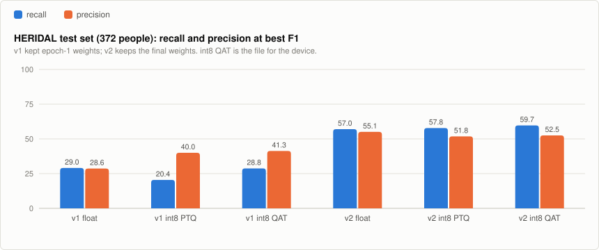

# voxOCR

**voxOCR** is a tiny person detector for **drone search and rescue**,
small enough for an ESP32-S3-class microcontroller: 136,547 parameters and a
**197 KB full-int8 TensorFlow Lite** file. It looks at a 160×160 RGB tile
from a downward-looking camera and marks where people are, so a drone can
flag places worth a closer look and report them to the rescue team.

It is the sibling of [InviolusOCR](https://github.com/ErdemWilkinson/InviolusOCR)
(Turkish line OCR) and uses the same toolchain and methods. It does not read
text. Text and people are kept in separate models so that each stays small.

**Status: first trained version, measured on the HERIDAL test set. Not yet
run on a device or on real flight footage.**

## Model

- **Input:** 160×160 RGB tile, scaled to `[-1, 1]` (`pixel / 127.5 - 1`).
- **Output:** a 40×40×3 grid (stride 4). Channel 0 is the person-centre
  heatmap (sigmoid). Channels 1 and 2 are `log(width)` and `log(height)` of
  the box in grid cells.
- **Architecture:** CenterNet-style and anchor-free (as in PP-PicoDet).
  - Depthwise-separable backbone down to stride 16, then a small FPN back up
    to stride 4.
  - Only Conv2D, DepthwiseConv2D, batch norm, ReLU, Add and nearest
    upsampling, all of which quantize cleanly and exist in TFLite Micro.
- **Detections:** local maxima of the heatmap (3×3 max-pool) above a
  threshold.

## Data and training

- **Data:** [HERIDAL](https://zenodo.org/records/5662351) (CC BY 3.0).
  4000×3000 aerial photos of people in Croatian terrain, with the official
  train/val/test split (1391 / 155 / 101 photos).
- **Tiles** (`scripts/prepare_heridal.py`):
  - Cut at 320, 480 and 640 px and resized to 160, to imitate different
    flying heights.
  - Training uses tiles centred near people, random tiles (mostly empty
    terrain), and **CopyPaste** tiles that have people pasted onto other
    backgrounds.
  - Validation and test cover each photo with a regular grid of 640 px
    crops: 5,425 val tiles (317 people) and 3,507 test tiles (372 people).
    At this scale a person is about 10 to 28 px tall in the tile.
- **Loss:** focal loss on the heatmap, plus 0.1 × L1 on log size at the
  centres.
- **Augmentation:**
  - Flips and 90° turns (a downward camera has no "up").
  - Colour, contrast, haze, blur and sensor noise.
- **Schedule:** 150 minutes of float training with cosine learning-rate
  decay, then 40 minutes of quantization-aware training (QAT), on CPU.

```
python scripts/prepare_heridal.py <heridal_voc_folder> D:/datasets/voxocr
VOX_DATA=D:/datasets/voxocr VOX_MAX_MINUTES=150 VOX_QAT_MINUTES=40 python scripts/train.py
VOX_DATA=D:/datasets/voxocr python scripts/export_and_evaluate.py val test
```

## Results

A detection counts as a find when its centre lies inside a person's box
grown by one grid cell. Each person can be found once.

- **Recall:** the share of people found. Recall comes first: a missed person
  costs more than a false alarm.
- **Precision:** the share of detections that are people.

<picture>
  <source media="(prefers-color-scheme: dark)" srcset="docs/voxocr-test-v1-v2-dark.svg">
  
</picture>

**v1** kept the weights with the lowest validation loss, which turned out to
be epoch 1. Validation tiles are mostly empty terrain and training tiles are
mostly people, so validation loss swung from epoch to epoch and was a poor
guide. **v2** keeps the final weights of the cosine schedule.

HERIDAL test set, 3,507 tiles, 372 people:

| Version | Threshold | Recall | Precision | False alarms per tile |
|---|---:|---:|---:|---:|
| v1 int8 QAT, best F1 | 0.45 | 28.8% | 41.3% | 0.04 |
| v2 float, best F1 | 0.45 | 57.0% | 55.1% | 0.05 |
| **v2 int8 QAT, best F1** | 0.45 | **59.7%** | 52.5% | 0.06 |
| v2 int8 QAT, recall first | 0.30 | 74.5% | 29.8% | 0.19 |
| v2 int8 QAT, recall first | 0.20 | **82.5%** | 15.8% | 0.47 |
| v2 int8 QAT, recall first | 0.10 | 86.6% | 5.5% | 1.58 |

**int8 costs nothing measurable.** The QAT int8 file is within half a point
of the float model in recall at every threshold above, and ahead of it at the
best-F1 point. Post-training quantization (PTQ) alone
is within about 1.5 points.

**What this means for a search flight:** at threshold 0.2 the int8 model
finds 82.5% of people and raises about one false alarm every two tiles.
Only flagged tiles need to go to the operator, and a person is usually seen
in several frames. Per-tile recall is a lower bound for per-flight recall,
which has not been measured.

## Limitations

- **One dataset:** HERIDAL is summer, daytime, mostly Mediterranean terrain.
  Snow, forest canopy, water, night and thermal are untested.
- The 90% recall target is not reached on the test set (86.6% at the lowest
  threshold).
- Not yet run on an ESP32-S3. Speed and memory on the device are unmeasured.
- Boxes are coarse (stride 4). The model is built to say *where to look*, not
  to measure people.

## Next steps

- More aerial person data with clear licences (e.g. SeaDronesSee for water,
  WiSARD for other terrain).
- Longer training: the train loss was still falling when the budget ended.
- Run on an ESP32-S3 with TFLite Micro or ESP-DL and measure latency.

## License

Code: [MIT](LICENSE). Trained weights: CC BY 4.0 with HERIDAL attribution;
see [MODEL_LICENSE.md](MODEL_LICENSE.md). Trained weights are published at
[inviolus/voxOCR](https://huggingface.co/inviolus/voxOCR).

voxOCR is built for search and rescue, to help find people who need help.
It is not intended for targeting or harming people.
