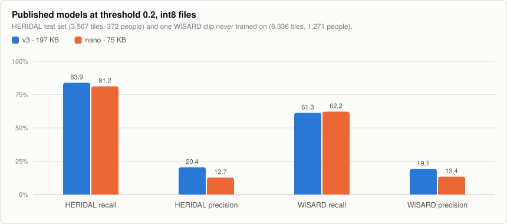
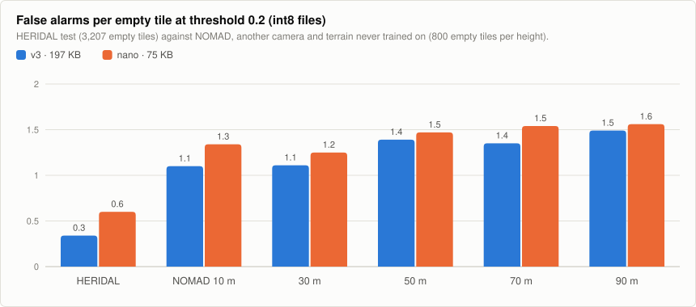
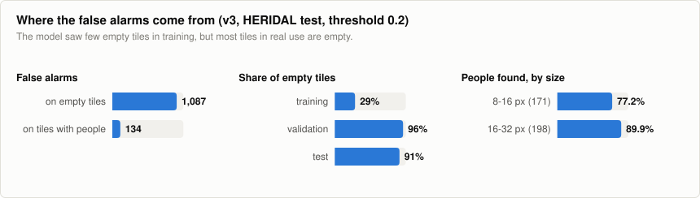
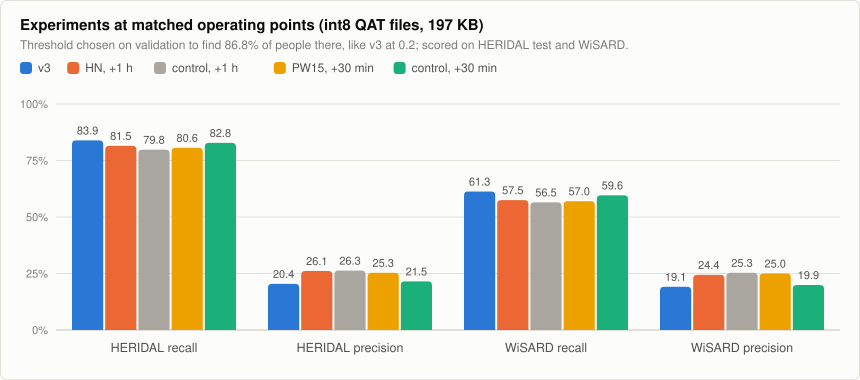
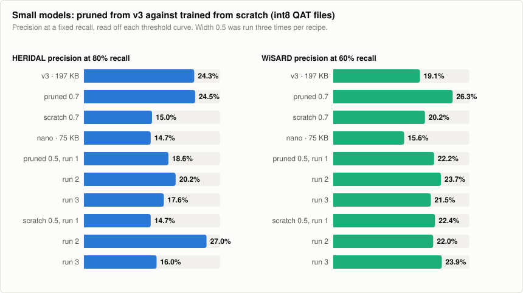
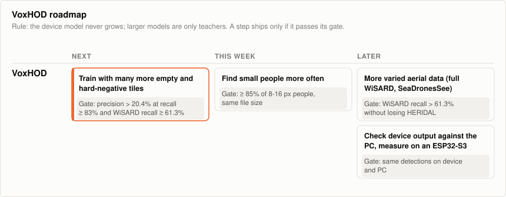

# VoxHOD: tiny aerial person detector

*Keywords: human detection, person detection, aerial, drone, search and rescue,
TFLite, int8, TinyML, ESP32-S3, microcontroller.*

**VoxHOD** is a tiny, general-purpose person detector for **aerial images**,
small enough for an ESP32-S3-class microcontroller: 136,547 parameters and a
**197 KB full-int8 TensorFlow Lite** file, or 37,363 parameters and **75 KB**
for the nano variant. It looks at a 160×160 RGB tile
from a downward-looking camera and marks where people are, so a drone can
flag places worth a closer look. Search and rescue is the use it has been
trained and measured for so far.

It is the sibling of [InviolusOCR](https://github.com/ErdemWilkinson/InviolusOCR)
(Turkish line OCR) and uses the same toolchain and methods. It does not read
text. Text and people are kept in separate models so that each stays small.

**Status:** measured on the HERIDAL test set and, as external checks, on one
WiSARD clip and on 4,000 empty NOMAD tiles from another camera. Speed, memory
and the output on real tiles are checked on an ESP32-P4 board. Not yet run in
flight. Published: v3 (197 KB) and nano (75 KB) on
[Hugging Face](https://huggingface.co/inviolus/VoxHOD). See
[Results](#results), [Version history](#version-history) and
[Roadmap](#roadmap).

## Model

- **Input:** 160×160 RGB tile, scaled to `[-1, 1]` (`pixel / 127.5 - 1`).
- **Output:** a 40×40×3 grid (stride 4). Channel 0 is the person-centre
  heatmap (sigmoid). Channels 1 and 2 are `log(width)` and `log(height)` of
  the box in grid cells.
- **Architecture:** CenterNet-style and anchor-free (as in PP-PicoDet).
  - Depthwise-separable backbone down to stride 16, then a small FPN back up
    to stride 4.
  - Only Conv2D, DepthwiseConv2D, batch norm, ReLU, Add and nearest
    upsampling, all of which quantize cleanly and exist in TFLite Micro.
- **Detections:** local maxima of the heatmap (3×3 max-pool) above a
  threshold.

## Data and training

- **Data:** [HERIDAL](https://zenodo.org/records/5662351) (CC BY 3.0).
  4000×3000 aerial photos of people in Croatian terrain, with the official
  train/val/test split (1391 / 155 / 101 photos).
- **Tiles** (`scripts/prepare_heridal.py`):
  - Cut at 320, 480 and 640 px and resized to 160, to imitate different
    flying heights.
  - Training uses tiles centred near people, random tiles (mostly empty
    terrain), and **CopyPaste** tiles that have people pasted onto other
    backgrounds.
  - Validation and test cover each photo with a regular grid of 640 px
    crops: 5,425 val tiles (317 people) and 3,507 test tiles (372 people).
    At this scale a person is about 10 to 28 px tall in the tile.
- **Loss:** focal loss on the heatmap, plus 0.1 × L1 on log size at the
  centres.
- **Augmentation:**
  - Flips and 90° turns (a downward camera has no "up").
  - Colour, contrast, haze, blur and sensor noise.
- **Schedule:** float training with cosine learning-rate decay, then
  quantization-aware training (QAT).

```
python scripts/prepare_heridal.py <heridal_voc_folder> D:/datasets/voxhod
VOX_DATA=D:/datasets/voxhod VOX_MAX_MINUTES=150 VOX_QAT_MINUTES=40 python scripts/train.py
VOX_DATA=D:/datasets/voxhod python scripts/export_and_evaluate.py val test

# compare int8 files at matched operating points (threshold chosen on val; first model is the reference)
VOX_SPLITS=val,test,wisard,nomad_tn python scripts/threshold_sweep.py sweep/ v3=v3.tflite other=other.tflite
# prune v3 to 70% width, then continue training it from the pruned weights
VOX_WIDTH=0.7 python scripts/prune.py artifacts_v3/voxhod.keras pruned_0.7.h5
VOX_WIDTH=0.7 VOX_WARM_START=pruned_0.7.h5 VOX_LR=1e-3 VOX_MAX_MINUTES=30 VOX_QAT_MINUTES=10 python scripts/train.py
```

## Results

A detection counts as a find when its centre lies inside a person's box
grown by one grid cell. Each person can be found once.

- **Recall:** the share of people found. Recall comes first: a missed person
  costs more than a false alarm.
- **Precision:** the share of detections that are people.

<picture>
  <source media="(prefers-color-scheme: dark)" srcset="docs/voxhod-models-dark.svg">
  
</picture>

The WiSARD sample (`scripts/prepare_wisard.py`) is an external test only,
never trained on: one clip of 264 correlated frames from another camera, cut
into 6,336 tiles with 1,271 people. The full 40.5 GB set could not be
downloaded, so treat it as a first signal.

| Model, int8 | Threshold | HERIDAL recall | Precision | False alarms per tile | WiSARD recall | Precision | False alarms per tile |
|---|---:|---:|---:|---:|---:|---:|---:|
| **v3 QAT, 197 KB** | 0.1 | 88.7% | 7.7% | 1.12 | 73.6% | 8.2% | 1.66 |
| **v3 QAT, 197 KB** | 0.2 | **83.9%** | 20.4% | 0.35 | **61.3%** | 19.1% | 0.52 |
| **v3 QAT, 197 KB** | 0.3 | 76.6% | 32.5% | 0.17 | 52.6% | 32.0% | 0.22 |
| **nano PTQ, 75 KB** | 0.1 | 89.5% | 4.8% | 1.87 | 73.6% | 5.2% | 2.70 |
| **nano PTQ, 75 KB** | 0.2 | **81.2%** | 12.7% | 0.59 | **62.2%** | 13.4% | 0.81 |
| **nano PTQ, 75 KB** | 0.3 | 72.3% | 25.8% | 0.22 | 52.0% | 28.1% | 0.27 |

Thresholds are fixed here rather than picked on the test set.

- **At threshold 0.2, v3 finds 84% of people** and raises about one false
  alarm every three tiles. Only flagged tiles need to go to the operator, and
  a person is usually seen in several frames, so per-tile recall is a lower
  bound for per-flight recall (not measured yet).
- **nano keeps most of the recall at 38% of the file size,** but raises about
  1.7 times as many false alarms.
- **Recall drops by about 20 points on WiSARD.** HERIDAL scores do not carry
  over to other cameras and scenes.
- **int8 costs nothing measurable.** The QAT int8 file is within about half a
  point of the float model.

### False alarms on unseen terrain (NOMAD)

[NOMAD](https://github.com/ArtRuss/NOMAD) (CC BY 4.0) publishes 500 frames with
nobody in them, 100 at each flight distance from 10 to 90 m, from a camera and
terrain VoxHOD never saw. `scripts/prepare_nomad_tn.py` cuts 8 random 640 px crops
from each frame and resizes them to 160 like the HERIDAL tiles: 4,000 empty
tiles, so every detection is a false alarm. Test only, never trained on.

<picture>
  <source media="(prefers-color-scheme: dark)" srcset="docs/voxhod-nomad-dark.svg">
  
</picture>

| int8 file, threshold 0.2 | HERIDAL empty tiles | NOMAD, all | 10 m | 30 m | 50 m | 70 m | 90 m |
|---|---:|---:|---:|---:|---:|---:|---:|
| v3 | 0.34 | **1.29** | 1.10 | 1.11 | 1.39 | 1.35 | 1.49 |
| nano | 0.60 | **1.43** | 1.34 | 1.25 | 1.47 | 1.54 | 1.56 |

False alarms per empty tile.

- **On unseen terrain v3 raises almost four times as many false alarms** as on
  empty HERIDAL tiles (1.29 against 0.34 per tile), and more from higher up.
- They cluster: 38% of NOMAD tiles get at least one, with about 3.4 on each of
  those. At threshold 0.3 v3 drops to 0.74 per tile.
- This is the clearest sign so far that the model needs more varied empty
  terrain, not only more people.

### Where the false alarms come from

An analysis of v3 on the HERIDAL test set at threshold 0.2 (2026-11-07, no
training involved):

<picture>
  <source media="(prefers-color-scheme: dark)" srcset="docs/voxhod-diagnosis-dark.svg">
  
</picture>

- **89% of false alarms are on tiles with nobody in them** (1,087 of 1,221).
- **The training tiles are mostly people:** only 29% of training tiles are
  empty, against 96% of validation and 91% of test tiles. The model has had
  little practice at saying "nobody here".
- **Stricter peak picking does not fix it:** a 5×5 instead of 3×3 peak window
  raised precision by only 0.5 points.
- **Small people are found less often:** 77% of people 8 to 16 px tall,
  against 90% of people 16 to 32 px tall.

### Experiments: fewer false alarms without losing people (2026-11-08 and 09)

**How models are compared.** A fixed threshold is unfair between models whose
scores are calibrated differently: a model that has seen many empty tiles gives
lower scores everywhere, so at 0.2 it looks more precise and less sensitive at
the same time. `scripts/threshold_sweep.py` therefore picks each model's
threshold on the **validation** set so that it finds as many people there as v3
does at 0.2 (86.8%), and only then scores it on the test set, WiSARD and NOMAD.
A paired bootstrap over tiles gives the 95% interval of each difference to v3.
To ship, a model must keep test recall (lower end of the interval no worse than
−1.5 points), not lose WiSARD recall, and raise fewer false alarms, also on
NOMAD, without a bigger file.

The runs in this table continue from v3 for the stated time on the laptop GPU,
then get 10 to 20 minutes of quantization-aware training. Each change has a
control that got the same extra training on the unchanged recipe.

<picture>
  <source media="(prefers-color-scheme: dark)" srcset="docs/voxhod-experiments-dark.svg">
  
</picture>

| int8 QAT file, 197 KB | Threshold | HERIDAL recall (vs v3, 95%) | Precision | False alarms per tile | WiSARD recall (vs v3, 95%) | Precision | NOMAD false alarms per tile |
|---|---:|---:|---:|---:|---:|---:|---:|
| **v3 (published)** | 0.20 | **83.9%** | 20.4% | 0.35 | **61.3%** | 19.1% | 1.29 |
| HN: +1 h, 58% empty and hard-negative tiles | 0.17 | 81.5% (−5.1 to +0.3) | 26.1% | 0.24 | 57.5% (−5.3 to −2.4) | 24.4% | 1.11 |
| control: +1 h, old tiles | 0.23 | 79.8% (−6.5 to −1.7) | 26.3% | 0.24 | 56.5% (−6.4 to −3.3) | 25.3% | 0.95 |
| PW15: +30 min, missed people weigh 1.5× | 0.26 | 80.6% (−5.2 to −1.4) | 25.3% | 0.25 | 57.0% (−5.8 to −2.9) | 25.0% | 0.99 |
| control: +30 min, old recipe | 0.21 | 82.8% (−2.7 to +0.5) | 21.5% | 0.32 | 59.6% (−3.0 to −0.5) | 19.9% | 1.17 |

- **Hard negatives did not cause the gain.** At matched operating points the
  hard-negative model and its control are the same within noise. The fewer false
  alarms reported on 2026-11-08 at threshold 0.2 came from the extra hour of
  low-learning-rate training, which makes scores more cautious, not from the
  empty tiles.
- **Weighting missed people 1.5× did not keep recall.** Against its own control
  it found 2.2 points fewer people on HERIDAL and 2.6 fewer on WiSARD.
- **Every continuation trades people for false alarms.** Each one finds fewer
  people on WiSARD than v3 at the same validation recall. Validation did not
  predict this: it has only 317 people from one camera.
- **Nothing passed the gate; v3 stays published.**

**Pruning instead of training a small model from scratch.** `scripts/prune.py`
removes the channels with the smallest batch-norm scale from v3 (network
slimming), keeping the channels that are joined by Add layers in step, then
trains the slim model for 30 minutes. The control trains the same architecture
from scratch for the same 30 minutes. Width 0.7 gives 68,374 parameters
(116 KB); width 0.5 gives the nano architecture (37,363 parameters, 78 KB as a QAT file).

<picture>
  <source media="(prefers-color-scheme: dark)" srcset="docs/voxhod-pruning-dark.svg">
  
</picture>

| int8 QAT file | Size | HERIDAL recall (vs v3, 95%) | Precision | False alarms per tile | Precision at 80% HERIDAL recall | WiSARD recall | NOMAD false alarms per tile |
|---|---:|---:|---:|---:|---:|---:|---:|
| v3 (published) | 197 KB | 83.9% | 20.4% | 0.35 | 24.3% | 61.3% | 1.29 |
| P07: pruned to 0.7 | 116 KB | 79.3% (−7.7 to −1.5) | 25.6% | 0.24 | 24.5% | 63.7% | 1.11 |
| S07: 0.7 from scratch | 116 KB | 79.8% (−7.7 to −0.3) | 18.5% | 0.37 | 15.0% | 62.9% | 1.13 |
| nano (published, PTQ) | 75 KB | 83.1% | 10.3% | 0.77 | 14.7% | 64.8% | 1.71 |
| P05: pruned to 0.5, runs 1 / 2 / 3 | 78 KB | 82.0 / 81.2 / 78.5% | 15.2 / 20.2 / 21.7% | 0.48 / 0.34 / 0.30 | 18.6 / 20.2 / 17.6% | 67.9 / 65.4 / 62.5% | 1.77 / 1.50 / 1.40 |
| S05: 0.5 from scratch, runs 1 / 2 / 3 | 78 KB | 83.3 / 83.1 / 82.3% | 12.7 / 18.0 / 12.2% | 0.61 / 0.40 / 0.63 | 14.7 / 27.0 / 16.0% | 69.0 / 62.4 / 69.7% | 1.63 / 1.11 / 1.48 |

Threshold chosen on validation as above. Precision at 80% recall is read off each
model's threshold curve on the test set. The three runs differ only in random
data order, augmentation and (from scratch) starting weights.

- **Runs of the same recipe differ a lot.** At width 0.5, precision at 80% recall
  ranges from 17.6% to 20.2% for the pruned runs and from 14.7% to 27.0% from
  scratch. A single run says little, so every small-model result here needs
  repeats.
- **Pruning is not better than training from scratch at width 0.5.** Averaged
  over three runs, precision at 80% recall is the same (18.8% against 19.2%),
  and the pruned runs find about 2 points fewer people on HERIDAL.
- **At width 0.7 the single pruned run looks better** (24.5% against 15.0% at
  80% recall, as good as v3 at 59% of its size), but it was not repeated, and
  it finds 4.6 points fewer people than v3 at the matched operating point.
- **All six 30-minute runs raise fewer false alarms than the published nano**
  (0.30 to 0.63 against 0.77 per tile). They had quantization-aware training,
  which the published nano did not.
- **None replaces nano.** Picked by validation precision, the best candidate
  (pruned run 3) finds 78.5% of people on HERIDAL against nano's 83.1%, and the
  QAT files are 78 KB against nano's 75 KB. Nano stays published.

**Looking for a better nano (2026-11-09 afternoon).** The 30-minute small models
above raise fewer false alarms than nano, so a follow-up tried to turn that into
a new nano: quantization-aware training of nano itself (NQ), nano trained 30
more minutes (NC30), a fourth from-scratch run (S05d), and the PTQ (75 KB)
versions of all runs. The candidate was to be **picked on validation**
(highest precision at the matched recall) and then compared with nano on the
test sets, here with nano as the reference of the bootstrap.

| int8 file | Size | Validation precision | HERIDAL recall (vs nano, 95%) | False alarms per tile | WiSARD recall (vs nano, 95%) | NOMAD false alarms per tile |
|---|---:|---:|---:|---:|---:|---:|
| nano (published, PTQ) | 75 KB | 5.4% | 83.1% | 0.77 | 64.8% | 1.71 |
| NQ: nano + 10 min QAT | 78 KB | 7.5% | 81.7% (−3.6 to +0.8) | 0.53 | 62.3% (−3.9 to −1.1) | 1.35 |
| NC30: nano + 30 min + QAT | 78 KB | 6.3% | 82.3% (−3.0 to +1.4) | 0.62 | 62.9% (−3.2 to −0.6) | 1.48 |
| NC30, PTQ | 75 KB | 5.5% | 81.7% (−3.9 to +1.1) | 0.72 | 67.0% (+0.8 to +3.5) | 1.66 |
| **picked on validation:** pruned run 3, PTQ | 75 KB | 15.0% | 76.9% (−9.2 to −3.2) | 0.24 | 59.2% (−7.6 to −3.6) | 1.24 |
| from scratch, run 4 | 78 KB | 3.7% | 87.4% (+0.8 to +7.4) | 1.29 | 70.4% (+3.3 to +7.8) | 2.29 |
| from scratch, run 1 (best-looking on test) | 78 KB | 6.9% | 83.3% (−3.1 to +3.6) | 0.61 | 69.0% (+2.1 to +6.2) | 1.63 |

- **Nothing passed; nano stays.** The validation pick gives up 6 points of
  recall. Every candidate with fewer false alarms also finds fewer people
  somewhere, and the one that finds more people (run 4) raises 1.7 times the
  false alarms: they slide along the same trade-off.
- **Run 1 looks better than nano on every set, but it was spotted by looking at
  the test results** among 18 files, and its file is 3 KB larger. Choosing it
  would be choosing on the test set, so it is not published.
- **Validation is too small to set the threshold.** All models are matched to
  the same recall on validation (317 people), yet on the test set their recall
  spreads from 77% to 87%. A larger validation split is now the first thing to
  fix before any further comparison.
- **The test set is also small for this gate.** With 372 people the 95%
  interval of a recall difference is about ±3 points, so "lower end no worse
  than −1.5" only lets a clearly better model through. The gate was not
  loosened after seeing the results.

Results: `ocr/artifacts/night-2026-11-08/` and `night-2026-11-09/` in the
InviolusOCR repository, where the overnight runs are logged.

### Version history

All rows: HERIDAL test set, int8 file, threshold 0.2. Runs from 2026-11-09 on
are compared at matched operating points instead; see
[Experiments](#experiments-fewer-false-alarms-without-losing-people-2026-11-08-and-09).

| Version | Date | What changed | HERIDAL recall / precision | WiSARD recall / precision | Status |
|---|---|---|---:|---:|---|
| v1 | 2026-10 | first run; kept the lowest-validation-loss weights | 71.0% / 3.5% | n/m | replaced |
| v2 | 2026-10 | kept the final weights of the cosine schedule instead | 82.5% / 15.8% | n/m | replaced |
| **v3** | 2026-11-01 | v2 + 7 hours | 83.9% / 20.4% | 61.3% / 19.1% | **on Hugging Face** |
| **nano** | 2026-11-02 | half width, from scratch (PTQ file) | 81.2% / 12.7% | 62.2% / 13.4% | **on Hugging Face** |
| v4 | 2026-11-06 | v3 + about 2 hours | 83.6% / 21.7% | 58.6% / 19.5% | not published: lower WiSARD recall |
| control | 2026-11-08 | v3 + 1 GPU hour, old tiles | 81.7% / 22.1% | 58.8% / 21.0% | control only |
| HN | 2026-11-08 | v3 + 1 GPU hour, 58% empty and hard-negative tiles | 79.3% / 31.8% | 54.8% / 30.3% | not published: lower recall |
| V30, PW15 | 2026-11-09 | v3 + 30 min; PW15 weighs missed people 1.5× | see Experiments | see Experiments | not published: lower recall |
| P07, S07 | 2026-11-09 | width 0.7 (116 KB): pruned from v3, and from scratch | see Experiments | see Experiments | not published: lower HERIDAL recall |
| P05, S05 | 2026-11-09 | width 0.5 (nano size): pruned from v3, and from scratch, 3 runs each | see Experiments | see Experiments | not published: no run beat nano at the same recall |
| NQ, NC30, S05d | 2026-11-09 | nano + QAT; nano + 30 min; a 4th from-scratch run | see Experiments | see Experiments | not published: picked on validation, it lost recall |

n/m: not measured. v1 picked its weights by validation loss, but validation
tiles are mostly empty and training tiles mostly people, so the lowest loss
was at epoch 1; v2 onward keep the final weights.

A separate non-commercial branch, [VoxHOD-NC](https://github.com/ErdemWilkinson/VoxHOD-NC),
adds drone footage by Ferhat Tatık (v2: HERIDAL 85.2% / 19.4%, WiSARD 70.5% /
22.4%). Its weights are CC BY-NC 4.0 and never go into this repository.

## Roadmap

<picture>
  <source media="(prefers-color-scheme: dark)" srcset="docs/roadmap-voxhod-dark.svg">
  
</picture>

Rule for every step: **the device model does not grow** beyond 197 KB (v3)
and 75 KB (nano). Larger models are only allowed as teachers. A step ships
only if it passes its gate.

Every gate is checked at matched operating points (threshold chosen on validation, see
[Experiments](#experiments-fewer-false-alarms-without-losing-people-2026-11-08-and-09)).

| Step | Why | Gate to ship | Status |
|---|---|---|---|
| Fewer false alarms without losing people | 89% of false alarms are on empty tiles; on unseen terrain (NOMAD) v3 raises 1.3 per empty tile | Test recall not lower (95% interval above −1.5 points), WiSARD recall not lower, fewer false alarms on HERIDAL and NOMAD | **tried 2026-11-08/09, not passed:** hard negatives, a 1.5× weight on missed people and plain extra training all lowered recall. Next: a larger teacher model (distillation), and more varied empty terrain with clear licences |
| More varied aerial data with clear licences (full WiSARD, SeaDronesSee for water) | Recall falls by about 20 points on WiSARD; false alarms quadruple on NOMAD | WiSARD recall above 61.3% without losing HERIDAL recall | open |
| Better recall on small people | 77% on 8-16 px people against 90% on larger ones | ≥ 85% on 8-16 px, same file size | planned |
| A larger validation split | 317 validation people cannot place models at the same operating point: matched there, their test recall spreads from 77% to 87% | Thresholds chosen on validation land within ±1 point of the target recall on test | **next** |
| Smaller files by pruning v3 (network slimming) | A 116 KB file could replace v3 where RAM is short | Same gates as v3 or nano, over 3 runs | **tried 2026-11-09:** at width 0.5 no better than from scratch over 3 runs; one 0.7 run matched v3's precision at 80% recall but lost recall at the matched point. Next: repeat 0.7 |
| Check the device output against the PC, measure on an ESP32-S3 | The output on the device was unchecked | Same people found on device and PC | **P4 done 2026-11-09:** same recall on 163 tiles; ESP32-S3 open |

Training moved to a laptop GPU on 2026-11-07 (WSL2, TensorFlow 2.15.1), so
each of these is a matter of hours instead of a night.

## On-device measurement (ESP32-P4)

Measured on 2026-11-06 on one ESP32-P4 board (rev v1.3, 360 MHz, 32 MB flash, 32 MB PSRAM) with ESP-IDF 5.3.5 and `esp-tflite-micro` 1.4.2. Each row is the mean of 20 runs after 2 warm-up runs; the published files were measured byte for byte. One inference is one 160x160 RGB tile.

| Model | File | Arena used | Latency, arena in internal SRAM | Latency, arena in PSRAM (200 MHz) |
|---|---:|---:|---:|---:|
| VoxHOD v3 | 197 KB | 332 KB | 321 ms | 347 ms |
| VoxHOD nano | 75 KB | 218 KB | 151 ms | 159 ms |

The weights stay in flash; the arena only holds the activations. Both models fit in internal SRAM.
At 321 ms a tile, the P4 scans about 3 tiles a second.

**Output on real tiles (2026-11-09).** 163 HERIDAL test tiles (149 people) were
run through both published files on the same board and compared with the PC
interpreter at threshold 0.2 ([benchmarks/esp32-p4-check](benchmarks/esp32-p4-check)):

| File | Heatmap cells bit-identical | Largest difference | Recall, PC | Recall, device |
|---|---:|---:|---:|---:|
| v3 | 92.1% | 3 int8 steps | 81.9% | 81.9% |
| nano | 48.8% | 6 int8 steps | 79.9% | 80.5% |

- **The device finds the same people as the PC** within one person on these tiles.
- The output is not bit-identical: the device's ESP-NN kernels round differently,
  which adds or removes single detections near the threshold (16 of 163 tiles for v3).
- ESP-NN's accelerated kernels are active on the P4. The first check firmware
  crashed inside one of them (`esp_nn_conv_s8_1x1`); copying the model to a
  16-byte aligned buffer and aligning the arena fixed it.

What the timing does and does not show:

- Random int8 input for the timing; only the model inference is timed, not image
  decoding, resizing or box extraction.
- It is an ESP32-P4, not an ESP32-S3. The numbers do not carry over to the S3, which has other cores.
- One board. Source and raw output: [benchmarks/esp32-p4](https://github.com/ErdemWilkinson/InviolusOCR/tree/master/benchmarks/esp32-p4).

## Memory budget on ESP32 chips

The arena (the RAM a model needs while it runs) was measured on the ESP32-P4 and is
almost the same on other ESP32 chips. Free RAM on the P4 was measured in the benchmark
firmware; free RAM on the S3 and C6 are **estimates** for typical ESP-IDF projects, and the
real value depends on the firmware. The C6 has no PSRAM, so everything must fit in its
internal SRAM. Not included: camera frame buffers and the application's own memory.

Arena as a share of the chip's internal SRAM:

| Model | Arena | ESP32-S3 (512 KB) | ESP32-C6 (512 KB) | ESP32-P4 (768 KB) |
|---|---:|---:|---:|---:|
| v3 | 332 KB | 65% | 65% | 43% |
| nano | 218 KB | 43% | 43% | 28% |

Arena as a share of the RAM that is actually free (✅ fits comfortably, ⚠️ fits with little
room left, ❌ does not fit):

| Model | P4, 569 KB free (measured) | S3, Wi-Fi off, ~350 KB (est.) | S3, Wi-Fi on, ~250 KB (est.) | C6, Wi-Fi off, ~400 KB (est.) | C6, Wi-Fi + BLE on, ~200 KB (est.) |
|---|---:|---:|---:|---:|---:|
| v3 | 58% ✅ | 95% ❌* | 133% ❌* | 83% ⚠️ | 166% ❌ |
| nano | 38% ✅ | 62% ✅ | 87% ⚠️ | 55% ✅ | 109% ❌ |

\* With PSRAM on the S3 the arena can move there and the model runs, more slowly.

Flash is not the limit (v3 takes 5% of a 4 MB flash). On an ESP32-S3 (240 MHz) the latency
is estimated at roughly 1.2 to 2.5 times the P4's (v3 about 0.4 to 0.8 s, nano about 0.2 to
0.4 s per tile), not measured. In short: on an ESP32-S3 without PSRAM, use nano.

## Limitations

- **One training dataset:** HERIDAL is summer, daytime, mostly Mediterranean
  terrain. Recall falls by about 20 points on the one WiSARD clip. Snow, forest
  canopy, water, night and thermal are untested.
- **Many false alarms:** at threshold 0.2 only one detection in five is a
  person (see [Where the false alarms come from](#where-the-false-alarms-come-from)),
  and on unseen terrain (NOMAD) v3 raises about 1.3 false alarms per empty tile,
  rising with flight height.
- The 90% recall target is not reached on the test set (v3 88.7%, nano 89.5% at
  threshold 0.1, the lowest shown).
- Boxes are coarse (stride 4). The model is built to say *where to look*, not
  to measure people.

## License

**Not trained on the Ferhat Tatık footage.** That footage is licensed to this project for non-commercial use only, so models trained on it are published separately as [VoxHOD-NC](https://github.com/ErdemWilkinson/VoxHOD-NC) (CC BY-NC 4.0). VoxHOD stays CC BY 4.0.

External test data only, never trained on: one WiSARD clip (D. Broyles, C. R. Hayner,
K. Leung, IROS 2022) and the NOMAD true-negative frames
([ArtRuss/NOMAD](https://github.com/ArtRuss/NOMAD), CC BY 4.0).

Code: [MIT](LICENSE). Trained weights (v3 and nano): CC BY 4.0 with HERIDAL attribution;
see [MODEL_LICENSE.md](MODEL_LICENSE.md). Trained weights are published at
[inviolus/VoxHOD](https://huggingface.co/inviolus/VoxHOD).

VoxHOD is a general-purpose aerial person detector. Search and rescue is the
use it has been trained and measured for so far: helping find people who are
lost or injured. Other settings are unmeasured. It is not intended for
targeting or harming people.
