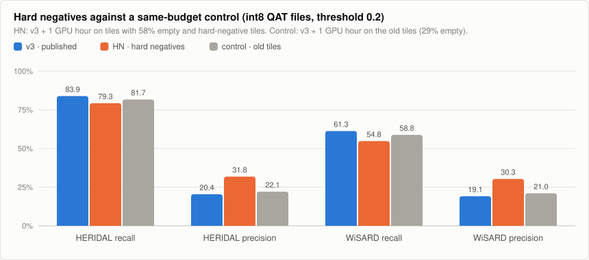

# VoxHOD: tiny aerial person detector

*Keywords: human detection, person detection, aerial, drone, search and rescue,
TFLite, int8, TinyML, ESP32-S3, microcontroller.*

**VoxHOD** is a tiny, general-purpose person detector for **aerial images**,
small enough for an ESP32-S3-class microcontroller: 136,547 parameters and a
**197 KB full-int8 TensorFlow Lite** file, or 37,363 parameters and **75 KB**
for the nano variant. It looks at a 160×160 RGB tile
from a downward-looking camera and marks where people are, so a drone can
flag places worth a closer look. Search and rescue is the use it has been
trained and measured for so far.

It is the sibling of [InviolusOCR](https://github.com/ErdemWilkinson/InviolusOCR)
(Turkish line OCR) and uses the same toolchain and methods. It does not read
text. Text and people are kept in separate models so that each stays small.

**Status:** measured on the HERIDAL test set and, as a first external check,
on one WiSARD clip. Speed and memory are measured on an ESP32-P4 board. Not
yet run in flight. Published: v3 (197 KB) and nano (75 KB) on
[Hugging Face](https://huggingface.co/inviolus/VoxHOD). See
[Results](#results), [Version history](#version-history) and
[Roadmap](#roadmap).

## Model

- **Input:** 160×160 RGB tile, scaled to `[-1, 1]` (`pixel / 127.5 - 1`).
- **Output:** a 40×40×3 grid (stride 4). Channel 0 is the person-centre
  heatmap (sigmoid). Channels 1 and 2 are `log(width)` and `log(height)` of
  the box in grid cells.
- **Architecture:** CenterNet-style and anchor-free (as in PP-PicoDet).
  - Depthwise-separable backbone down to stride 16, then a small FPN back up
    to stride 4.
  - Only Conv2D, DepthwiseConv2D, batch norm, ReLU, Add and nearest
    upsampling, all of which quantize cleanly and exist in TFLite Micro.
- **Detections:** local maxima of the heatmap (3×3 max-pool) above a
  threshold.

## Data and training

- **Data:** [HERIDAL](https://zenodo.org/records/5662351) (CC BY 3.0).
  4000×3000 aerial photos of people in Croatian terrain, with the official
  train/val/test split (1391 / 155 / 101 photos).
- **Tiles** (`scripts/prepare_heridal.py`):
  - Cut at 320, 480 and 640 px and resized to 160, to imitate different
    flying heights.
  - Training uses tiles centred near people, random tiles (mostly empty
    terrain), and **CopyPaste** tiles that have people pasted onto other
    backgrounds.
  - Validation and test cover each photo with a regular grid of 640 px
    crops: 5,425 val tiles (317 people) and 3,507 test tiles (372 people).
    At this scale a person is about 10 to 28 px tall in the tile.
- **Loss:** focal loss on the heatmap, plus 0.1 × L1 on log size at the
  centres.
- **Augmentation:**
  - Flips and 90° turns (a downward camera has no "up").
  - Colour, contrast, haze, blur and sensor noise.
- **Schedule:** float training with cosine learning-rate decay, then
  quantization-aware training (QAT).

```
python scripts/prepare_heridal.py <heridal_voc_folder> D:/datasets/voxhod
VOX_DATA=D:/datasets/voxhod VOX_MAX_MINUTES=150 VOX_QAT_MINUTES=40 python scripts/train.py
VOX_DATA=D:/datasets/voxhod python scripts/export_and_evaluate.py val test
```

## Results

A detection counts as a find when its centre lies inside a person's box
grown by one grid cell. Each person can be found once.

- **Recall:** the share of people found. Recall comes first: a missed person
  costs more than a false alarm.
- **Precision:** the share of detections that are people.

<picture>
  <source media="(prefers-color-scheme: dark)" srcset="docs/voxhod-models-dark.svg">
  
</picture>

The WiSARD sample (`scripts/prepare_wisard.py`) is an external test only,
never trained on: one clip of 264 correlated frames from another camera, cut
into 6,336 tiles with 1,271 people. The full 40.5 GB set could not be
downloaded, so treat it as a first signal.

| Model, int8 | Threshold | HERIDAL recall | Precision | False alarms per tile | WiSARD recall | Precision | False alarms per tile |
|---|---:|---:|---:|---:|---:|---:|---:|
| **v3 QAT, 197 KB** | 0.1 | 88.7% | 7.7% | 1.12 | 73.6% | 8.2% | 1.66 |
| **v3 QAT, 197 KB** | 0.2 | **83.9%** | 20.4% | 0.35 | **61.3%** | 19.1% | 0.52 |
| **v3 QAT, 197 KB** | 0.3 | 76.6% | 32.5% | 0.17 | 52.6% | 32.0% | 0.22 |
| **nano PTQ, 75 KB** | 0.1 | 89.5% | 4.8% | 1.87 | 73.6% | 5.2% | 2.70 |
| **nano PTQ, 75 KB** | 0.2 | **81.2%** | 12.7% | 0.59 | **62.2%** | 13.4% | 0.81 |
| **nano PTQ, 75 KB** | 0.3 | 72.3% | 25.8% | 0.22 | 52.0% | 28.1% | 0.27 |

Thresholds are fixed here rather than picked on the test set.

- **At threshold 0.2, v3 finds 84% of people** and raises about one false
  alarm every three tiles. Only flagged tiles need to go to the operator, and
  a person is usually seen in several frames, so per-tile recall is a lower
  bound for per-flight recall (not measured yet).
- **nano keeps most of the recall at 38% of the file size,** but raises about
  1.7 times as many false alarms.
- **Recall drops by about 20 points on WiSARD.** HERIDAL scores do not carry
  over to other cameras and scenes.
- **int8 costs nothing measurable.** The QAT int8 file is within about half a
  point of the float model.

### Where the false alarms come from

An analysis of v3 on the HERIDAL test set at threshold 0.2 (2026-11-07, no
training involved):

<picture>
  <source media="(prefers-color-scheme: dark)" srcset="docs/voxhod-diagnosis-dark.svg">
  
</picture>

- **89% of false alarms are on tiles with nobody in them** (1,087 of 1,221).
- **The training tiles are mostly people:** only 29% of training tiles are
  empty, against 96% of validation and 91% of test tiles. The model has had
  little practice at saying "nobody here".
- **Stricter peak picking does not fix it:** a 5×5 instead of 3×3 peak window
  raised precision by only 0.5 points.
- **Small people are found less often:** 77% of people 8 to 16 px tall,
  against 90% of people 16 to 32 px tall.

### Trying the fix: hard negatives (2026-11-08)

`scripts/mine_negatives.py` scored 40 empty crops of every training photo with
v3 and added the 4 it was most wrongly sure about (hard negatives, median score
0.37, above the 0.2 threshold) plus 3 random empty ones: 9,737 tiles, so 58% of
training tiles are now empty instead of 29%. **HN** continued v3 for one GPU
hour on these tiles. The **control** continued v3 for the same hour on the old
tiles, so the comparison isolates the data. Both got 20 minutes of
quantization-aware training afterwards (HN's ran on the CPU because it did not
fit the 6 GB GPU, so it had fewer steps).

<picture>
  <source media="(prefers-color-scheme: dark)" srcset="docs/voxhod-hard-negatives-dark.svg">
  
</picture>

| int8 QAT file, threshold 0.2 | HERIDAL recall | Precision | False alarms per tile | Best F1 | WiSARD recall | Precision | Best F1 |
|---|---:|---:|---:|---:|---:|---:|---:|
| v3 (published) | **83.9%** | 20.4% | 0.35 | 0.569 | **61.3%** | 19.1% | 0.449 |
| control (old tiles) | 81.7% | 22.1% | 0.30 | 0.566 | 58.8% | 21.0% | 0.453 |
| HN (hard negatives) | 79.3% | **31.8%** | **0.18** | **0.609** | 54.8% | **30.3%** | **0.475** |

- **The diagnosis was right:** the hard negatives halved the false alarms and
  raised the best F1 on both sets. The control, with the same extra training
  on the old tiles, gained nothing.
- **But the model became more cautious:** it finds 4.6 points fewer people at
  threshold 0.2, and at recall ≥ 83% its precision is no better than v3's.
  The gate (more precision without losing recall) is not passed, so v3 stays
  the published model. For search and rescue, a missed person costs more than
  a false alarm.
- Next: fewer hard negatives per photo, or a loss that weighs missed people
  more, to keep recall while cutting false alarms.

Results: `ocr/artifacts/night-2026-11-08/evaluation_vox_*.json` in the
InviolusOCR repository, where the overnight runs are logged.

### Version history

All rows: HERIDAL test set, int8 file, threshold 0.2.

| Version | Date | What changed | HERIDAL recall / precision | WiSARD recall / precision | Status |
|---|---|---|---:|---:|---|
| v1 | 2026-10 | first run; kept the lowest-validation-loss weights | 71.0% / 3.5% | n/m | replaced |
| v2 | 2026-10 | kept the final weights of the cosine schedule instead | 82.5% / 15.8% | n/m | replaced |
| **v3** | 2026-11-01 | v2 + 7 hours | 83.9% / 20.4% | 61.3% / 19.1% | **on Hugging Face** |
| **nano** | 2026-11-02 | half width, from scratch (PTQ file) | 81.2% / 12.7% | 62.2% / 13.4% | **on Hugging Face** |
| v4 | 2026-11-06 | v3 + about 2 hours | 83.6% / 21.7% | 58.6% / 19.5% | not published: lower WiSARD recall |
| control | 2026-11-08 | v3 + 1 GPU hour, old tiles | 81.7% / 22.1% | 58.8% / 21.0% | control only |
| HN | 2026-11-08 | v3 + 1 GPU hour, 58% empty and hard-negative tiles | 79.3% / 31.8% | 54.8% / 30.3% | not published: lower recall |

n/m: not measured. v1 picked its weights by validation loss, but validation
tiles are mostly empty and training tiles mostly people, so the lowest loss
was at epoch 1; v2 onward keep the final weights.

A separate non-commercial branch, [VoxHOD-NC](https://github.com/ErdemWilkinson/VoxHOD-NC),
adds drone footage by Ferhat Tatık (v2: HERIDAL 85.2% / 19.4%, WiSARD 70.5% /
22.4%). Its weights are CC BY-NC 4.0 and never go into this repository.

## Roadmap

<picture>
  <source media="(prefers-color-scheme: dark)" srcset="docs/roadmap-voxhod-dark.svg">
  
</picture>

Rule for every step: **the device model does not grow** beyond 197 KB (v3)
and 75 KB (nano). Larger models are only allowed as teachers. A step ships
only if it passes its gate.

| Step | Why | Gate to ship | Status |
|---|---|---|---|
| Train with many more empty and hard-negative tiles | 89% of false alarms are on empty tiles; training has 29% empty tiles | HERIDAL precision above 20.4% at recall ≥ 83% (threshold 0.2), and WiSARD recall ≥ 61.3% | **tried 2026-11-08, not passed:** false alarms halved, recall 79.3%. Next: fewer hard negatives or a recall-weighted loss |
| Better recall on small people | 77% on 8-16 px people against 90% on larger ones | ≥ 85% on 8-16 px, same file size | planned |
| More varied aerial data with clear licences (full WiSARD, SeaDronesSee for water) | Recall falls by about 20 points on WiSARD | WiSARD recall above 61.3% without losing HERIDAL recall | open |
| Check the device output against the PC interpreter, measure on an ESP32-S3 | Only speed and memory are measured so far, on a P4 | Same detections on device and PC | open |

Training moved to a laptop GPU on 2026-11-07 (WSL2, TensorFlow 2.15.1), so
each of these is a matter of hours instead of a night.

## On-device measurement (ESP32-P4)

Measured on 2026-11-06 on one ESP32-P4 board (rev v1.3, 360 MHz, 32 MB flash, 32 MB PSRAM) with ESP-IDF 5.3.5 and `esp-tflite-micro` 1.4.2. Each row is the mean of 20 runs after 2 warm-up runs; the published files were measured byte for byte. One inference is one 160x160 RGB tile.

| Model | File | Arena used | Latency, arena in internal SRAM | Latency, arena in PSRAM (200 MHz) |
|---|---:|---:|---:|---:|
| VoxHOD v3 | 197 KB | 332 KB | 321 ms | 347 ms |
| VoxHOD nano | 75 KB | 218 KB | 151 ms | 159 ms |

The weights stay in flash; the arena only holds the activations. Both models fit in internal SRAM.
At 321 ms a tile, the P4 scans about 3 tiles a second.

What this does and does not show:

- Random int8 input: this is **speed and memory only**. The output was not compared with the PC
  interpreter, so correctness on the device is unchecked.
- Only the model inference is timed, not image decoding, resizing, box extraction.
- It is an ESP32-P4, not an ESP32-S3. The numbers do not carry over to the S3, which has other cores.
- Whether ESP-NN's accelerated kernels are active for the P4 was not checked, so the speed may improve.
- One board. Source and raw output: [benchmarks/esp32-p4](https://github.com/ErdemWilkinson/InviolusOCR/tree/master/benchmarks/esp32-p4).

## Memory budget on ESP32 chips

The arena (the RAM a model needs while it runs) was measured on the ESP32-P4 and is
almost the same on other ESP32 chips. Free RAM on the P4 was measured in the benchmark
firmware; free RAM on the S3 and C6 are **estimates** for typical ESP-IDF projects, and the
real value depends on the firmware. The C6 has no PSRAM, so everything must fit in its
internal SRAM. Not included: camera frame buffers and the application's own memory.

Arena as a share of the chip's internal SRAM:

| Model | Arena | ESP32-S3 (512 KB) | ESP32-C6 (512 KB) | ESP32-P4 (768 KB) |
|---|---:|---:|---:|---:|
| v3 | 332 KB | 65% | 65% | 43% |
| nano | 218 KB | 43% | 43% | 28% |

Arena as a share of the RAM that is actually free (✅ fits comfortably, ⚠️ fits with little
room left, ❌ does not fit):

| Model | P4, 569 KB free (measured) | S3, Wi-Fi off, ~350 KB (est.) | S3, Wi-Fi on, ~250 KB (est.) | C6, Wi-Fi off, ~400 KB (est.) | C6, Wi-Fi + BLE on, ~200 KB (est.) |
|---|---:|---:|---:|---:|---:|
| v3 | 58% ✅ | 95% ❌* | 133% ❌* | 83% ⚠️ | 166% ❌ |
| nano | 38% ✅ | 62% ✅ | 87% ⚠️ | 55% ✅ | 109% ❌ |

\* With PSRAM on the S3 the arena can move there and the model runs, more slowly.

Flash is not the limit (v3 takes 5% of a 4 MB flash). On an ESP32-S3 (240 MHz) the latency
is estimated at roughly 1.2 to 2.5 times the P4's (v3 about 0.4 to 0.8 s, nano about 0.2 to
0.4 s per tile), not measured. In short: on an ESP32-S3 without PSRAM, use nano.

## Limitations

- **One training dataset:** HERIDAL is summer, daytime, mostly Mediterranean
  terrain. Recall falls by about 20 points on the one WiSARD clip. Snow, forest
  canopy, water, night and thermal are untested.
- **Many false alarms:** at threshold 0.2 only one detection in five is a
  person (see [Where the false alarms come from](#where-the-false-alarms-come-from)).
- The 90% recall target is not reached on the test set (v3 88.7%, nano 89.5% at
  threshold 0.1, the lowest shown).
- Boxes are coarse (stride 4). The model is built to say *where to look*, not
  to measure people.

## License

**Not trained on the Ferhat Tatık footage.** That footage is licensed to this project for non-commercial use only, so models trained on it are published separately as [VoxHOD-NC](https://github.com/ErdemWilkinson/VoxHOD-NC) (CC BY-NC 4.0). VoxHOD stays CC BY 4.0.

Code: [MIT](LICENSE). Trained weights (v3 and nano): CC BY 4.0 with HERIDAL attribution;
see [MODEL_LICENSE.md](MODEL_LICENSE.md). Trained weights are published at
[inviolus/VoxHOD](https://huggingface.co/inviolus/VoxHOD).

VoxHOD is a general-purpose aerial person detector. Search and rescue is the
use it has been trained and measured for so far: helping find people who are
lost or injured. Other settings are unmeasured. It is not intended for
targeting or harming people.
