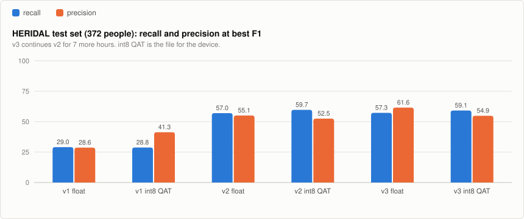
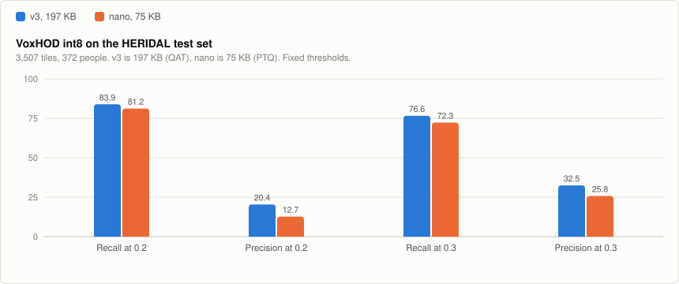
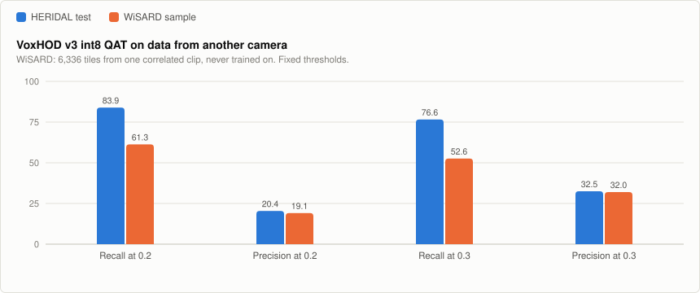

# VoxHOD: tiny person detector for drone search and rescue

*Keywords: human detection, person detection, aerial, drone, search and rescue,
TFLite, int8, TinyML, ESP32-S3, microcontroller.*

**VoxHOD** is a tiny person detector for **drone search and rescue**,
small enough for an ESP32-S3-class microcontroller: 136,547 parameters and a
**197 KB full-int8 TensorFlow Lite** file, or 37,363 parameters and **75 KB**
for the nano variant. It looks at a 160×160 RGB tile
from a downward-looking camera and marks where people are, so a drone can
flag places worth a closer look and report them to the rescue team.

It is the sibling of [InviolusOCR](https://github.com/ErdemWilkinson/InviolusOCR)
(Turkish line OCR) and uses the same toolchain and methods. It does not read
text. Text and people are kept in separate models so that each stays small.

**Status: measured on the HERIDAL test set and, as a first external check, on
one WiSARD clip. Not yet run on a device or in flight.**

## Model

- **Input:** 160×160 RGB tile, scaled to `[-1, 1]` (`pixel / 127.5 - 1`).
- **Output:** a 40×40×3 grid (stride 4). Channel 0 is the person-centre
  heatmap (sigmoid). Channels 1 and 2 are `log(width)` and `log(height)` of
  the box in grid cells.
- **Architecture:** CenterNet-style and anchor-free (as in PP-PicoDet).
  - Depthwise-separable backbone down to stride 16, then a small FPN back up
    to stride 4.
  - Only Conv2D, DepthwiseConv2D, batch norm, ReLU, Add and nearest
    upsampling, all of which quantize cleanly and exist in TFLite Micro.
- **Detections:** local maxima of the heatmap (3×3 max-pool) above a
  threshold.

## Data and training

- **Data:** [HERIDAL](https://zenodo.org/records/5662351) (CC BY 3.0).
  4000×3000 aerial photos of people in Croatian terrain, with the official
  train/val/test split (1391 / 155 / 101 photos).
- **Tiles** (`scripts/prepare_heridal.py`):
  - Cut at 320, 480 and 640 px and resized to 160, to imitate different
    flying heights.
  - Training uses tiles centred near people, random tiles (mostly empty
    terrain), and **CopyPaste** tiles that have people pasted onto other
    backgrounds.
  - Validation and test cover each photo with a regular grid of 640 px
    crops: 5,425 val tiles (317 people) and 3,507 test tiles (372 people).
    At this scale a person is about 10 to 28 px tall in the tile.
- **Loss:** focal loss on the heatmap, plus 0.1 × L1 on log size at the
  centres.
- **Augmentation:**
  - Flips and 90° turns (a downward camera has no "up").
  - Colour, contrast, haze, blur and sensor noise.
- **Schedule:** 150 minutes of float training with cosine learning-rate
  decay, then 40 minutes of quantization-aware training (QAT), on CPU.

```
python scripts/prepare_heridal.py <heridal_voc_folder> D:/datasets/voxhod
VOX_DATA=D:/datasets/voxhod VOX_MAX_MINUTES=150 VOX_QAT_MINUTES=40 python scripts/train.py
VOX_DATA=D:/datasets/voxhod python scripts/export_and_evaluate.py val test
```

## Results

A detection counts as a find when its centre lies inside a person's box
grown by one grid cell. Each person can be found once.

- **Recall:** the share of people found. Recall comes first: a missed person
  costs more than a false alarm.
- **Precision:** the share of detections that are people.

<picture>
  <source media="(prefers-color-scheme: dark)" srcset="docs/voxhod-test-v1-v2-dark.svg">
  
</picture>

**v1** kept the weights with the lowest validation loss, which turned out to
be epoch 1. Validation tiles are mostly empty terrain and training tiles are
mostly people, so validation loss swung from epoch to epoch and was a poor
guide. **v2** keeps the final weights of the cosine schedule.

HERIDAL test set, 3,507 tiles, 372 people:

| Version | Threshold | Recall | Precision | False alarms per tile |
|---|---:|---:|---:|---:|
| v1 int8 QAT, best F1 | 0.45 | 28.8% | 41.3% | 0.04 |
| v2 float, best F1 | 0.45 | 57.0% | 55.1% | 0.05 |
| **v2 int8 QAT, best F1** | 0.45 | **59.7%** | 52.5% | 0.06 |
| v2 int8 QAT, recall first | 0.30 | 74.5% | 29.8% | 0.19 |
| v2 int8 QAT, recall first | 0.20 | **82.5%** | 15.8% | 0.47 |
| v2 int8 QAT, recall first | 0.10 | 86.6% | 5.5% | 1.58 |

**int8 costs nothing measurable.** The QAT int8 file is within half a point
of the float model in recall at every threshold above, and ahead of it at the
best-F1 point. Post-training quantization (PTQ) alone
is within about 1.5 points.

**What this means for a search flight:** at threshold 0.2 the int8 model
finds 82.5% of people and raises about one false alarm every two tiles.
Only flagged tiles need to go to the operator, and a person is usually seen
in several frames. Per-tile recall is a lower bound for per-flight recall,
which has not been measured.

### v3 (2026-11-01): 7 more hours from v2

v2 continued for 7 hours (`VOX_WARM_START`) plus 40 minutes of QAT. On the
same test set the int8 QAT file now finds **83.9%** of people at threshold
0.2 (v2: 82.5%). False alarms drop from 0.47 to **0.35 per tile**. Best F1
rises from 0.558 to 0.569 (float: 0.560 to 0.593). Results:
`artifacts_v3/evaluation.json`.

<picture>
  <source media="(prefers-color-scheme: dark)" srcset="docs/voxhod-test-v1-v3-dark.svg">
  
</picture>

### 2026-11-02: a 75 KB nano model and a test on other data

- **nano** is the same architecture at half width (`VOX_WIDTH=0.5`), trained
  from scratch for 225 minutes plus 30 minutes of QAT: 37,363 parameters. Its
  post-training quantized (PTQ) file is 75 KB. Its QAT file is 78 KB and scored
  no better, so PTQ is the file to use.
- **WiSARD** (`scripts/prepare_wisard.py`) is an external test only, never
  trained on. The 40.5 GB full set could not be downloaded (Google Drive quota),
  so this uses the 971 MB sample: one clip, 264 correlated frames from another
  camera, cut into 6,336 tiles with 1,271 people. Treat it as a first signal.

<picture>
  <source media="(prefers-color-scheme: dark)" srcset="docs/voxhod-test-v3-nano-dark.svg">
  
</picture>

| Model, int8 | Threshold | HERIDAL recall | Precision | False alarms per tile | WiSARD recall | Precision | False alarms per tile |
|---|---:|---:|---:|---:|---:|---:|---:|
| **v3 QAT, 197 KB** | 0.1 | 88.7% | 7.7% | 1.12 | 73.6% | 8.2% | 1.66 |
| **v3 QAT, 197 KB** | 0.2 | **83.9%** | 20.4% | 0.35 | **61.3%** | 19.1% | 0.52 |
| **v3 QAT, 197 KB** | 0.3 | 76.6% | 32.5% | 0.17 | 52.6% | 32.0% | 0.22 |
| **nano PTQ, 75 KB** | 0.1 | 89.5% | 4.8% | 1.87 | 73.6% | 5.2% | 2.70 |
| **nano PTQ, 75 KB** | 0.2 | **81.2%** | 12.7% | 0.59 | **62.2%** | 13.4% | 0.81 |
| **nano PTQ, 75 KB** | 0.3 | 72.3% | 25.8% | 0.22 | 52.0% | 28.1% | 0.27 |

Thresholds are fixed here rather than picked on the test set.

- **nano keeps most of the recall at 38% of the file size.** At threshold 0.2
  it finds 2.7 points fewer people on HERIDAL, but raises about 1.7 times as
  many false alarms.
- **Recall drops by about 20 points on WiSARD.** At threshold 0.2 v3 falls from
  83.9% to 61.3%. HERIDAL scores do not carry over to other cameras and scenes,
  so more varied training data is the clearest next step.

<picture>
  <source media="(prefers-color-scheme: dark)" srcset="docs/voxhod-v3-heridal-wisard-dark.svg">
  
</picture>

Results: `artifacts_nano/evaluation.json`, `artifacts_v3/evaluation_wisard.json`.
Hugging Face now serves v3 and nano.

## Limitations

- **One training dataset:** HERIDAL is summer, daytime, mostly Mediterranean
  terrain. Recall falls by about 20 points on the one WiSARD clip. Snow, forest
  canopy, water, night and thermal are untested.
- The 90% recall target is not reached on the test set (v3 88.7%, nano 89.5% at
  threshold 0.1, the lowest shown).
- Not yet run on an ESP32-S3. Speed and memory on the device are unmeasured.
- Boxes are coarse (stride 4). The model is built to say *where to look*, not
  to measure people.

## Next steps

- More aerial person data with clear licences (e.g. SeaDronesSee for water,
  and the full WiSARD set for other terrain).
- Run on an ESP32-S3 with TFLite Micro or ESP-DL and measure latency.

## License

Code: [MIT](LICENSE). Trained weights (v3 and nano): CC BY 4.0 with HERIDAL attribution;
see [MODEL_LICENSE.md](MODEL_LICENSE.md). Trained weights are published at
[inviolus/VoxHOD](https://huggingface.co/inviolus/VoxHOD).

VoxHOD is built for search and rescue, to help find people who need help.
It is not intended for targeting or harming people.
